# Plan: planning becomes its own process, and the flow becomes the numbered spec

> Copied from the approved plan with the naming override applied: `new-app-intake` / `update-app-intake` everywhere, "New App Intake" / "Update App Intake" in prose. Names are substituted mechanically, so code identifiers and line numbers (for example `finish_update_app_intake`, `:2030`) are today's code under the new naming; ticket 03 settles the exact renames.

## Context

Today the planner runs inside the Build Run (`BuildRun.plan_change`, `orchestrator/build_run.py:2030`). A single-change-set plan only exists in memory (it rewrites `self.task`/`self.spec`/`state.d["flags"]` and the coder starts at once); a multi-set plan files child issues and ends `planned`. New-app Intakes are never planned at all: `ready-for-staging` runs `infra/app-staging/stage.sh`, which creates the repo and dispatches one Build Run from the Intake text. So `proceed-with-change` can start coding before complete, written instructions exist.

Goal: planning is a separate process that starts as soon as the issue is labelled. It files child tickets (sub-issues) under the Intake, each a complete set of coding instructions sized to one feature flag so a bad prod deploy is rolled back by flipping that flag. `proceed-with-change` then only ever goes on a child whose body is complete.

The diagram below is also the **official spec** of the system. Every step has a stable ID (`group.step`, e.g. `4.9 Test deployed app`) so docs, tickets, tests and verification runs can cite it.

## Delivery: how the work is tracked and sequenced

Superseded by the map: see [map.md](map.md) and `tickets/`. The ticket order there is the delivery order. The "Changes" sections below remain the content of the work, but each is carried out inside its **group** (a package per diagram group, see ticket 04), not spliced into the existing modules.

## Decisions (confirmed with the user)

- **No `begin-planning` label and no `ready-for-staging` label.** Planning starts when the issue label is applied: `update-app-intake` (Update App Intake form, and the automated sources) or `new-app-intake` (new app).
- **Rename the `intake` label to `new-app-intake`.**
- **Parent link: GitHub native sub-issues**, not the `plan:<n>` label.
- **The first child of a new app is the staging child**: it stages the app and puts infrastructure, connections and verification first, before any business logic. Later children carry the business logic, each behind one flag.
- **Hand-off is automatic**: the planner adds `proceed-with-change` to the first ready child; the existing `update_app_intake.advance` (`update_app_intake.py:232`) chains the rest. When a child's Build Run succeeds, `finalize` closes it and `advance` gives `proceed-with-change` (PAT) to the next open `waiting-on-plan` child whose dependencies are all closed. One child at a time; a failed child blocks its siblings.
- **Fix first, never retry unchanged.** When a child fails, the retrospective names the cause. App cause: the planner files a **fix child** under the same parent, ahead of the failed one; the failed child resumes only after the fix child closes. Factory cause: a `factory-fix-request` goes to a learning PR, and the failed child resumes after the PR merges and template sync reaches the app. No cause or infrastructure: `needs-human`. Today's automatic retry (`fixrequest.file_app_retry` `:323`, `should_autostart` `:123`, `fix_request_max_attempts: 2`) is removed.
- **Flags keep their current lifecycle** (STANDARDS-FEATURE-FLAGS.md, `flag_retirement.py`): one story, one flag; a failure keeps its flag, so the fix child reuses it (INV-39); a released flag is retired automatically by riding along in a later Build Run (up to 5, oldest first, the later run must also have `released`, at least 1 day soak, never a run of its own); a dark-broken feature is removed only after `approve-retire`. Retirement stays inside the Build Run; only the owner-approved `approve-retire` Intake is planned (one child, no flag).
- **Flag create/test/retire is deterministic and named after the issue.** Flag slug = `issue-<n>`, `<n>` the story's sub-issue number (a fix child inherits the original story's number). The Orchestrator creates the GrowthBook feature (production off) at the start of the child's Build Run so it exists while the coder and tester work; release only switches it on. A Starter check fails the commit unless each new flag has tests for flag-off and flag-on. Retirement stays coder-edited, with a deterministic verifier that rejects the commit while the slug appears in code, tests or `flags.json` (a codemod can come later). See section 10.
- **Bugs after release.** Flag still dark or off (not validated yet): the work is not complete, the same issue stays open and iterates (group 7). Flag on and validated (the system's meaning of fully released): a bug is a regression, filed as a **new `update-app-intake` issue labelled `bug`**, then planned like any change.

## The spec: flow diagram (numbered)

IDs are stable. Never renumber a step; add `.N+1` or retire an ID. Groups: 1 Request, 2 Planning, 3 Staging, 4 Build, 5 Flag lifecycle, 6 Record and advance, 7 Fix first, 8 Bugs found later.

```mermaid
flowchart TD
    subgraph g1["1. Request"]
        S1_1["<b>1.1 New App Intake submitted</b><br/>owner form, label new-app-intake"]
        S1_2["<b>1.2 Update App Intake submitted</b><br/>owner form, label update-app-intake"]
        S1_3["<b>1.3 Automated change request</b><br/>template sync, maintenance,<br/>production feedback, retirement<br/>filed with the PAT, label update-app-intake"]
    end

    S1_1 --> S2_1
    S1_2 --> S2_1
    S1_3 --> S2_1

    subgraph g2["2. Planning (plan.yml, its own process)"]
        S2_1["<b>2.1 Plan</b><br/>Planner Agent<br/>new app: reads the spec only<br/>update: reads the app's code"]
        S2_2["<b>2.2 Refuse</b><br/>comment: refused"]
        S2_3["<b>2.3 Stop for a person</b><br/>comment on the issue<br/>fix it, remove and re-add the label"]
        S2_4["<b>2.4 File child tickets</b><br/>sub-issues under the parent<br/>each body = complete coding instructions<br/>one flag each, sized to roll back alone"]
        S2_5["<b>2.5 Start the first child</b><br/>planner puts proceed-with-change<br/>on the first child with no dependencies"]
        S2_6{"<b>2.6 Route the child</b><br/>by kind"}
        S2_1 -->|"feasibility blocked"| S2_2
        S2_1 -->|"blocking question, bad plan,<br/>or missing secret"| S2_3
        S2_1 -->|"valid plan"| S2_4
        S2_4 --> S2_5
        S2_5 --> S2_6
    end

    S2_3 -.->|"retry"| S2_1

    subgraph g3["3. Staging (new app only, child 1)"]
        S3_1["<b>3.1 Stage the app</b><br/>stage.sh: repo from Starter, Fly app,<br/>flag service, Intake marker"]
        S3_2["<b>3.2 Verify infrastructure</b><br/>CI green, deploy healthy, flag round trip,<br/>preview token, secrets, smoke test<br/>no business logic, no flag<br/>TESTER Agent exercises the live app against the spec<br/>(first build, no flags: live on deploy)"]
        S3_1 --> S3_2
    end

    S2_6 -->|"staging"| S3_1

    subgraph g4["4. Build (every other child)"]
        S4_1["<b>4.1 Prepare the run</b><br/>read the child body only<br/>Orchestrator ensures flag issue-N exists, OFF"]
        S4_2["<b>4.2 Retire ride-along flags</b><br/>up to 5, oldest first,<br/>never a run of their own"]
        S4_3["<b>4.3 Code</b><br/>CODER Agent commits locally behind the flag<br/>format, build, unit tests incl. flag off and on"]
        S4_4["<b>4.4 Pre-review check</b><br/>Orchestrator: npm run check<br/>type-check, lint, flag off/on test check"]
        S4_5["<b>4.5 Review</b><br/>REVIEWER Agent reads the local commit<br/>BEFORE anything is pushed"]
        S4_6["<b>4.6 Push</b><br/>Orchestrator pushes with the PAT"]
        S4_7["<b>4.7 CI and dark deploy</b><br/>app CI: Test Gate, then deploy DARK<br/>flag off, nothing visible to users"]
        S4_8["<b>4.8 Diagnose pipeline failure</b><br/>PIPELINE Agent reads the logs<br/>coder fixes, reviewed again before any push"]
        S4_9["<b>4.9 Test the deployed app</b><br/>TESTER Agent runs AFTER the push<br/>Preview Token reaches the dark feature<br/>api-check and ui-check record every result<br/>repo tests, spot-check of behaviour that was live<br/>each check: passed / failed / blocked / not_run<br/>scope: new or existing"]
        S4_10["<b>4.10 Retest</b><br/>look again at the same deployed commit<br/>(test_retries 1), then needs-human"]
        S4_11["<b>4.11 Roll back the deploy</b><br/>rollback-fly: redeploy previous image<br/>flag stays off"]
        S4_12{"<b>4.12 Release gate</b><br/>CI green, deploy healthy,<br/>tester passed, reviewer clean,<br/>same SHA reviewed and pushed"}
        S4_13["<b>4.13 Release</b><br/>existing flag issue-N turned ON<br/>story labelled flag:issue-N<br/>watchdog watches the release"]
        S4_14["<b>4.14 Child fails</b><br/>child stays open, siblings keep waiting"]

        S4_1 --> S4_3
        S4_1 -.->|"at the start of every Build Run"| S4_2
        S4_3 --> S4_4
        S4_4 -->|"fails: back, costs no review"| S4_3
        S4_4 --> S4_5
        S4_5 -->|"blocking findings"| S4_3
        S4_5 -->|"clean"| S4_6
        S4_6 --> S4_7
        S4_7 -->|"CI or deploy fails"| S4_8
        S4_8 --> S4_3
        S4_7 --> S4_9
        S4_9 -->|"failed new check, rounds left<br/>(review_rounds 4, test_rounds 2)"| S4_3
        S4_9 -->|"blocked or not_run"| S4_10
        S4_10 --> S4_9
        S4_9 -->|"existing behaviour broke = regression"| S4_11
        S4_11 --> S4_14
        S4_9 -->|"all checks passed"| S4_12
        S4_9 -->|"rounds, cost cap or time limit used up,<br/>or same failures repeat (stuck)"| S4_14
        S4_12 -->|"pass"| S4_13
        S4_12 -->|"a gate does not hold"| S4_14
    end

    S2_6 -->|"update"| S4_1

    subgraph g5["5. Flag lifecycle (short-lived by design)"]
        S5_1["<b>5.1 Dark</b><br/>flag off, code deployed"]
        S5_2["<b>5.2 Released</b><br/>flag ON for everyone"]
        S5_3["<b>5.3 Eligible for retirement</b>"]
        S5_4["<b>5.4 Retired</b><br/>coder deletes the flag check, the flag-off tests<br/>and the flags.json line in its own commit; unwraps flag-on tests<br/>verifier rejects the commit while issue-N appears anywhere<br/>TESTER checks the behaviour is still on for an ordinary visitor<br/>flag archived in GrowthBook, story comment says so"]
        S5_5["<b>5.5 Dark-broken candidate</b><br/>watchdog switched it off<br/>flag stays, group 7 reuses the SAME flag"]
        S5_6["<b>5.6 Owner approves retirement</b><br/>adds approve-retire to the story"]
        S5_7["<b>5.7 Retirement intake</b><br/>update-app-intake, planned, one child, no flag<br/>deletes check, code, tests, flags.json line<br/>nothing removes a dark feature on its own"]
        S5_1 --> S5_2
        S5_2 -->|"a LATER Build Run also ends released<br/>and at least 1 day has passed"| S5_3
        S5_3 --> S4_2
        S4_2 --> S5_4
        S5_2 -->|"watchdog switches it off"| S5_5
        S5_5 -->|"fixed and released"| S5_2
        S5_5 -->|"cause not fixable:<br/>needs-human + dark-broken"| S5_6
        S5_6 --> S5_7
        S5_7 --> S5_4
    end

    S4_13 --> S5_2
    S4_1 -.->|"flag created OFF"| S5_1

    S3_2 --> S6_1
    S4_13 --> S6_1

    subgraph g6["6. Record and advance"]
        S6_1["<b>6.1 Child closed</b>"]
        S6_2["<b>6.2 Retrospective</b><br/>finalize + retrospective Agent<br/>(every run, always)<br/>summary, lessons, names the cause"]
        S6_3["<b>6.3 Advance to the next child</b><br/>next waiting child whose dependencies<br/>are closed gets proceed-with-change"]
        S6_4["<b>6.4 Parent closes</b><br/>last child closed"]
        S6_5(["<b>6.5 App live and recorded</b>"])
        S6_6["<b>6.6 Ongoing signals</b><br/>template sync, maintenance, owner requests"]
        S6_1 --> S6_2
        S6_2 -->|"child succeeded"| S6_3
        S6_3 -->|"last child closed"| S6_4
        S6_4 --> S6_5
        S6_5 --> S6_6
    end

    S4_14 --> S6_2
    S6_3 -->|"more children"| S2_6
    S6_6 --> S1_3
    S6_5 --> S1_2

    subgraph g7["7. Try fix (fix first, never retry the unchanged child)"]
        S7_1["<b>7.1 Fix child</b><br/>planner files it under the same parent,<br/>ahead of the failed one<br/>complete body, behind the SAME flag"]
        S7_2["<b>7.2 Factory fix request</b><br/>factory-fix-request issue"]
        S7_3["<b>7.3 Learning PR</b><br/>auto-merge if additive lint/format,<br/>else a human"]
        S7_4["<b>7.4 Resume the failed child</b><br/>PAT re-adds proceed-with-change"]
        S7_5["<b>7.5 Needs human</b><br/>nothing runs until the owner edits and re-labels"]
        S7_2 --> S7_3
        S7_3 -->|"merged; template sync carries it to the app"| S7_4
        S7_1 -->|"fix child closes"| S7_4
    end

    S6_2 -->|"failed: app cause<br/>(code wrong, spec ambiguous)"| S7_1
    S7_1 -->|"proceed-with-change"| S2_6
    S6_2 -->|"failed: factory cause<br/>(prompt, template, orchestrator)"| S7_2
    S6_2 -->|"no cause found / infrastructure"| S7_5
    S7_4 --> S4_1

    subgraph g8["8. Bugs found later"]
        S8_1["<b>8.1 Bug while still dark</b><br/>flag dark or off, not validated yet"]
        S8_2["<b>8.2 Validated release</b><br/>flag on and validated:<br/>feature is fully released"]
        S8_3["<b>8.3 Watch production</b><br/>watchdog, production feedback<br/>Fly errors, escaped-defect issue"]
        S8_4["<b>8.4 Regression issue</b><br/>new update-app-intake labelled bug<br/>for tracking and analysis"]
        S8_3 --> S8_1
        S8_3 --> S8_2
        S8_2 -->|"a bug now is a REGRESSION"| S8_4
    end

    S6_5 --> S8_3
    S8_1 -->|"same issue stays open,<br/>more iteration"| S6_2
    S8_4 --> S2_1
    S5_5 -.-> S8_1
```

### Step index (the IDs to cite)

| ID | Title | Actor | Main code today (or new) |
|---|---|---|---|
| 1.1 | New App Intake submitted | owner | `ISSUE_TEMPLATE/new-app-intake.yml` |
| 1.2 | Update App Intake submitted | owner | `ISSUE_TEMPLATE/update-app-intake.yml` |
| 1.3 | Automated change request | production_feedback, maintenance, template_sync, flag_retirement | each module's `file_*` |
| 2.1 | Plan | Planner Agent | new `plan_run.py` (from `plan_change`), `planner.py` |
| 2.2 | Refuse | Orchestrator | `triage.feasibility`, `Refused` |
| 2.3 | Stop for a person | Orchestrator | `NeedsHuman`, `AwaitingSecret` |
| 2.4 | File child tickets | Orchestrator | `update_app_intake.file_children` (sub-issues) |
| 2.5 | Start the first child | Orchestrator | `update_app_intake.ready_to_start` |
| 2.6 | Route the child | Orchestrator | `factory-plan` marker `kind` |
| 3.1 | Stage the app | stage.sh | `infra/app-staging/stage.sh` |
| 3.2 | Verify infrastructure | Orchestrator, Tester | Starter smoke test, tester |
| 4.1 | Prepare the run | Orchestrator | `BuildRun.setup`, new `ensure_feature` |
| 4.2 | Retire ride-along flags | Orchestrator, Coder | `flag_retirement.piggyback_slugs` |
| 4.3 | Code | Coder Agent | `agents/prompts/coder.md` |
| 4.4 | Pre-review check | Orchestrator | `limits.precheck` |
| 4.5 | Review | Reviewer Agent | `reviewer.md`, `banded_findings` |
| 4.6 | Push | Orchestrator | `BuildRun.push` |
| 4.7 | CI and dark deploy | app CI | Starter workflows |
| 4.8 | Diagnose pipeline failure | Pipeline Agent | pipeline role |
| 4.9 | Test the deployed app | Tester Agent | `tester.md`, `api_check.py`, `ui_check.py` |
| 4.10 | Retest | Orchestrator | `limits.test_retries` |
| 4.11 | Roll back the deploy | Orchestrator | `rollback-fly.yml` |
| 4.12 | Release gate | Orchestrator | `BuildRun.release` conditions |
| 4.13 | Release | Orchestrator | `BuildRun.release`, watchdog |
| 4.14 | Child fails | Orchestrator | `finish_update_app_intake` |
| 5.1-5.7 | Flag lifecycle | Orchestrator | `flag_retirement.py`, `flag_set.py`, `appstate.py` |
| 6.1 | Child closed | Orchestrator | `finish_update_app_intake` |
| 6.2 | Retrospective | Retrospective Agent | `retrospective.py`, `finalize` |
| 6.3 | Advance to the next child | Orchestrator | `update_app_intake.advance` |
| 6.4 | Parent closes | Orchestrator | new, in `advance` |
| 6.5 | App live and recorded | Orchestrator | `appstate.py` |
| 6.6 | Ongoing signals | scheduled workflows | `template_sync`, `maintenance` |
| 7.1 | Fix child | Planner | new, in `fixrequest.py` |
| 7.2 | Factory fix request | Orchestrator | `fixrequest.py` |
| 7.3 | Learning PR | Retrospective Agent | `factory-run.yml` |
| 7.4 | Resume the failed child | Orchestrator | new, in `fixrequest.py` |
| 7.5 | Needs human | Orchestrator | `needs-human` label |
| 8.1-8.4 | Bugs found later | production_feedback | `production_feedback.py` |

## Changes

### 0. Make the diagram the spec
- Create `docs/flow-spec.md` containing the diagram and step index above, with two extra columns filled in as work proceeds: "implemented by" and "verified by" (test name, invariant ID or live-check). IDs are stable; every other doc and ticket cites them (`STEP 4.9`). `docs/intake-cycle.md` and `docs/update-flow.md` link to it instead of duplicating diagrams; `docs/orchestrator-map.md` keeps the module and workflow maps.
- A small `flow_spec_test.py` checks the Mermaid block parses to unique step IDs and that every ID cited in `docs/*.md` and `docs/invariants.md` (`STEP n.m`) exists in the index. Invariant rows gain a `Step` column pointing at the spec step they enforce.
- A follow-up verification pass walks the index step by step: for each step, find the code, find the test or live check, record gaps (nothing in this plan runs live yet).

### 1. New workflow and module
- `.github/workflows/plan.yml`: `issues: labeled`, job-level `if` on label `new-app-intake` or `update-app-intake`. `concurrency: plan-<issue>`. Setup steps copied from `build-run.yml` (OpenHands, Agent-user isolation, pyyaml, unit tests first); no Node, Fly or Playwright. Env: `FACTORY_GH_TOKEN`, `FACTORY_PAT`, `DEEPINFRA_API_KEY`.
- `orchestrator/plan_run.py`: moves the body of `plan_change` out of the Build Run, reusing `BuildRun` helpers (`agent_json` `:1537`, `invoke` `:1464`, `require_secrets` `:2089`, `post_plan` `:2107`), `planner.validate_plan`/`topological_order`, `triage.feasibility`, `update_app_intake.render_plan_comment`/`secrets_marker`/`ensure_label`. Update App Intake: clones the app so the planner can read code. New app: no repo yet, plans from the spec alone (`build_kind = "first build"`).
- **Idempotent**: skip an issue that already has sub-issues (creation can fire both `opened` and `labeled`, and a retry must not duplicate).
- Endings: `planned`, `refused`, `awaiting_secret`, needs-human (blocking question, rejected plan). A non-planned ending comments and leaves the issue re-plannable: **retry = edit the issue, remove and re-add its label.**
- Verify before relying on it: that `labeled` fires for labels set at issue creation by a form, and that the automated sources create issues with the PAT (an Actions-token label event starts no workflow).

### 2. Children carry complete instructions (`orchestrator/update_app_intake.py`)
- Extend the `factory-plan` marker (`child_body` `:160`) with `kind` (`staging` | `update`), `flag`, `flag_story`, `internal_only`, `requirements`, `size`. Body keeps the rendered task (`render_change_set_task` `:125`): criteria, verification, out-of-scope.
- `file_children` (`:198`): create each issue, then `POST /repos/{o}/{r}/issues/{n}/sub_issues` with the child's numeric `id`. The marker still carries `depends_on` (sub-issues have none). `waiting-on-plan` stays; the `plan:<parent>` label goes.
- `siblings`/`ready_to_start`/`advance` (`:225-241`) list children with `GET .../sub_issues`. Keep one child at a time (INV-23).
- Verify the sub-issues endpoints with a read-only `gh api` GET on this repo first.

### 3. The staging child (new apps)
- The planner always makes child 1 `kind: staging`, no flag, no business logic. Its body states the acceptance criteria as infrastructure and verification, in this order: repo created from the Starter and CI green; deploy healthy on Fly; feature-flag service connected and a flag round trip works; Preview Token path works; declared secrets present; boot/health smoke test passing. Source the list from what `stage.sh` and the Starter's smoke test already check.
- Every business-logic child depends on child 1 and carries its own flag.
- `app-staging.yml` and `infra/app-staging/stage.sh` change from "triggered by `ready-for-staging` on an `intake` issue" to "triggered by `proceed-with-change` on a `kind: staging` child": stage the app (repo, Fly app, flag-service connection, `Intake: <factory>#<parent>` description marker, INV-22), then dispatch the Build Run for the staging child. `update-app-intake.yml` skips `kind: staging` children.
- The "one app through staging at a time" check in `stage.sh` (`max_simultaneous_build_runs`) stops counting `ready-for-staging` labels and counts open staging children in progress instead.
- `stage.sh` no longer closes the Intake; it comments the repo link on the parent. The parent closes when its last child closes.

### 4. Build Run stops planning (`orchestrator/build_run.py`)
- Delete `plan_change`, the planner gate in `run()` (`:2122-2124`), the `planned` outcome (`OK_OUTCOMES` `:59`; matching tuples in `audit.py`, `appstate.py`, `dashboard.py`, which INV-24 keeps in step), audit rule A-06, and the planner from `check_models` (`:1343`).
- `setup` (`:1178`): read `kind`, `flag`, `internal_only` from `plan_meta`; set `state.d["flags"]`, the spec and the reuse-flag check from them (today only `plan_change` does, `:2078`). The secrets check at `:1201` stays and reads the marker the planner wrote. `identify_intake` (`:100`) treats `kind: staging` as a first build even though the title is no longer the bare app name.
- An Update App Intake child with no `factory-plan` marker is refused ("not planned yet"). `update_app_intake.start` (`:244`) enforces the same, and its accepted comment no longer says "plans the change".
- No automatic retry: a failed child is only started again by the fix-first loop (section 9), which reuses the story's flag.

### 5. Automated sources and the label rename
- `production_feedback.py:173`, `maintenance.py`, `template_sync.py:145`, flag retirement: file the Update App Intake with the PAT so `update-app-intake` starts planning, instead of adding `proceed-with-change`. Drop "The planner runs first."
- Rename `intake` to `new-app-intake` in `.github/ISSUE_TEMPLATE/new-app-intake.yml`, `app-staging.yml`, `stage.sh`, `identify_intake`/`parse_intake` in `build_run.py`, `docs/golden-intakes.md`, `agents/benchmark/*`, docs and tests. The `Intake: <factory>#<n>` repo marker keeps its name. Remove every `ready-for-staging` reference (workflow, `stage.sh`, form text, `provider_blocked_test.py:128`, docs).

### 6. Planner prompt and rollback-sized change sets
- `agents/prompts/planner.md`: a change set is the smallest slice that is independently releasable and independently revertible by one flag; one flag wrapping the whole change in one place; no change set that only works while another's flag is on; data changes additive (STANDARDS-CODING "Data and migrations"); fits the run cost cap. For a new app: child 1 is staging and infrastructure verification, business logic only after it.
- `planner.py validate_plan`: add `size` (`S`/`M`, `L` rejected and must be split), a cap on criteria per change set (about 6), and for a new app require the first change set to be `kind: staging` with no other set before it. Keep the existing flag-required, no-tests-only and 8-set rules. Put the new limits in `agents/profiles.yml` beside `planner_max_change_sets`.
- `agents/planner-fixtures/cases.json`: add an over-large change set, a change set that needs another's flag on, and a new-app plan whose first set is not staging.

### 7. Forms, docs
- Issue forms say that submitting starts planning. Docs: `ARCHITECTURE.md` (Intake, Update App Intake, stages, citing step IDs), `GLOSSARY.md`, `docs/update-flow.md`, `docs/intake-cycle.md`, `docs/orchestrator-map.md` (`plan_run`, new `plan` workflow, 20 workflows), `docs/invariants.md`, .

### 8. Tests and invariants
- Move the `Planning` class in `update_app_intake_test.py` (~225-310) to a new `plan_run_test.py`; add tests for the sub-issue calls (mock `gh`), idempotency, the `plan.yml` trigger `if`, "no marker means refused", the staging-first rule and the size rules.
- Update `build_run_test.py` (`:161`, `:1245-1300`, `:531-542`), `finalize_test.py:116`, `rollback_test.py:25`, `retrospective_test.py:170`, `flag_retirement_test.py:144`, `provider_blocked_test.py:128`, `fixrequest_test.py`.
- Invariants: INV-23, INV-24, INV-25/26 (drop `planned`), INV-39, INV-40, INV-48 (its test inspects the source of `BuildRun.setup`; re-point to the planner for the first `awaiting_secret`). Add: "`proceed-with-change` is only put on an issue whose body has a `factory-plan` marker."

### 9. Failure, fix children and bugs (steps 6.2, 7.x, 8.x)
- **Retrospective stays where it is** (`build-run.yml` "Write Summary" and "Retrospective" steps, `if: always()`; `retrospective.py main`, `lessons_from`, `wants_fix_request`). It gains one job: for an app cause it asks `plan_run` to file a fix child instead of `fixrequest.file_app_retry` re-adding the label.
- **Blocking logic is unchanged and reused**: `finish_update_app_intake` (`build_run.py:2543`) leaves a failed child open and without `proceed-with-change`; `update_app_intake.ready_to_start`/`advance` (`:170-241`) only start a sibling whose dependencies are closed. The fix child is inserted as a dependency of the failed child (update its `depends_on` in the `factory-plan` marker), so the existing rule makes the failed child wait for it.
- **`fixrequest.py`**: replace the app-retry path with "file a fix child"; keep `route(category)` (`:46`) and the factory-cause path (`factory-fix-request`, `ready-for-factory-run`, learning PR). Add: when a learning PR for a failed child merges, the failed child gets `proceed-with-change` again (PAT). Keep `needs-human` and `dark-broken` (`build_run.py:2514`) for no-cause cases and `approve-retire` (`flag_retirement.py`).
- **Bug label**: `production_feedback.py` files post-release regressions as `update-app-intake` + `bug` (create the label with `ensure_label`). To decide "validated and flag on" versus "still dark", read the story's flag state from the App State issue (`appstate.py`); a dark/off flag appends to the existing story instead.
- Tests: `fixrequest_test.py` (retry cases become fix-child cases), `retrospective_test.py`, `production_feedback_test.py` (bug label and dark-vs-released routing), `update_app_intake_test.py` (fix child blocks the failed child). Update INV rows that mention automatic retry or `plan_gap`.

### 10. Deterministic flag lifecycle (steps 4.1, 4.3, 4.4, 4.13, group 5)
- **Name**: new `flag_slug(story_number)` in `build_run.py` (or `flag_set.py`) returns `issue-<n>`; GrowthBook key stays `<app>.feature.issue-<n>` (`feature_key`, `flag_set.py:19`). `SLUG_RE` (`planner.py:55`) is kept for validation. The planner no longer chooses a slug: remove slug selection from `agents/prompts/planner.md` (item 5), keep `flag: true|false/internal_only` on the change set, and drop the unique-slug check (unique by construction). The `factory-plan` marker records `flag_story`: the child's own number for a normal child, the failed story's number for a fix child.
- **Create at run start**: in `setup` (`build_run.py:1178`) the Orchestrator calls a new idempotent `ensure_feature(app, slug, issue_url)` (reuse the GrowthBook POST in `flag_set.py` and the creation code in `release` `:1931-1967`): production disabled, `defaultValue true`, description linking the story issue, `intake-<n>` tag, `flag_tags` (`:343`). It also writes the `flags.json` entry (slug + description starting with the issue ref) before the coder starts, so the coder only wraps code. Existing flags are never touched; a story's later children reuse its own.
- **Release** (`release` `:1931`) stops creating and only switches production on after the same four gates; the watchdog and the "retried story's own flag" exception are unchanged.
- **Dark mode is unit tested (deterministic check)**: add a Starter test helper `withFlag(slug, on, fn)` and an `npm run check` step (ESLint rule or small script, with cases in `agents/lint-fixtures/cases.json` run by `starter_lint_test.py`) that fails when a slug in `flags.json` lacks both a `withFlag(slug, false, ...)` and a `withFlag(slug, true, ...)` test, or has more than one `isFeatureEnabled` entry point. The pre-review `npm run check` (`limits.precheck`) already runs it, so a miss goes back to the coder at no review cost. Reaches existing apps through template sync.
- **Retirement removes the tests too**: extend the existing "reject the commit while code still mentions a retiring slug" check (`flag_retirement.py`, with its INV in `invariants_test.py`) to scan test files and `flags.json` as well as source, ignoring only comments. The retire prompt block tells the coder to delete the `withFlag(slug, false)` tests and unwrap the `withFlag(slug, true)` ones. A codemod that does this mechanically is a later ticket.
- **Naming links flag to sub-issue everywhere**: GrowthBook key and tag, `flag:issue-<n>` label (`flag_label` `:324`) and title tag (`title_with_flags` `:330`) on the story, `flags.json` description, App State issue. A test asserts the slug equals the sub-issue number the Build Run was started for.
- **Tests**: `build_run_test.py` (setup creates the flag once, a later child reuses it, a fix child uses `flag_story`), `flag_retirement_test.py` (tests removed with the flag, verifier rejects a leftover test mention), `starter_lint_test.py` + `lint-fixtures/cases.json` (missing off/on test is flagged), `planner_test.py` (no slug expected). Update INV-39 and add one: "a flag's slug is `issue-<n>` of its story".

## Risks
- Event assumptions above (labels at creation, PAT-created issues) are unverified; check with a test issue first.
- Open Intake or Update App Intake issues from before the change have no children; they must be re-labelled to be planned.
- Sub-issues API is new to this repo; on failure planning must fail loudly and leave the issue re-plannable, never file orphans.
- Staging moving inside the child flow is the largest change (`stage.sh`, `app-staging.yml`, the concurrency check); do it as its own step with its own tests.
- Step IDs become a public contract once docs cite them; treat renumbering as a breaking change.
- None of this has run live.

## Verification
1. `ruff check` and `python3 -m unittest discover -p "*_test.py" orchestrator` pass (INV table and tests stay in step; `flow_spec_test.py` passes).
2. `python3 orchestrator/planner.py validate` on the planner fixtures including the new cases.
3. Read-only `gh api repos/ojones/ai-factory/issues/<n>/sub_issues` to confirm the endpoint shape before the first write; a throwaway issue to confirm the `labeled`-at-creation event.
4. Live, Update App Intake on the bench app: submit the form, confirm planning starts unprompted (2.1), sub-issues appear (2.4), one child gets `proceed-with-change` (2.5), the Build Run reads only the child body (4.1), `advance` starts the next (6.3), the parent closes at the end (6.4).
5. Live, new app: submit a `new-app-intake`, confirm child 1 stages and verifies infrastructure with no business logic (3.1, 3.2), then flagged children build the app (group 4).
6. Walk the step index and record, per step, the implementing code and the verifying test or live check in `docs/flow-spec.md`.
