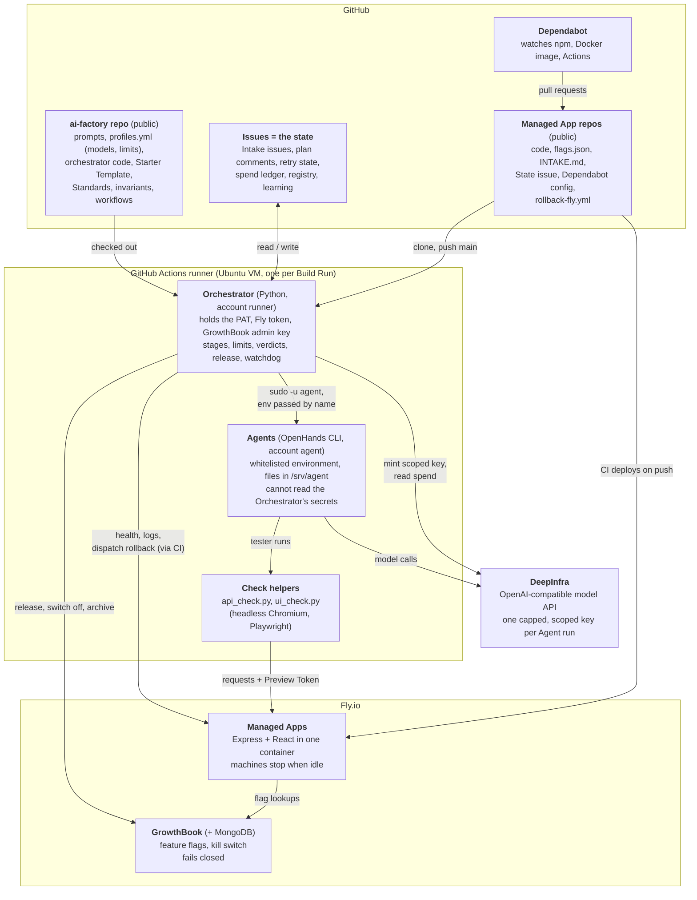
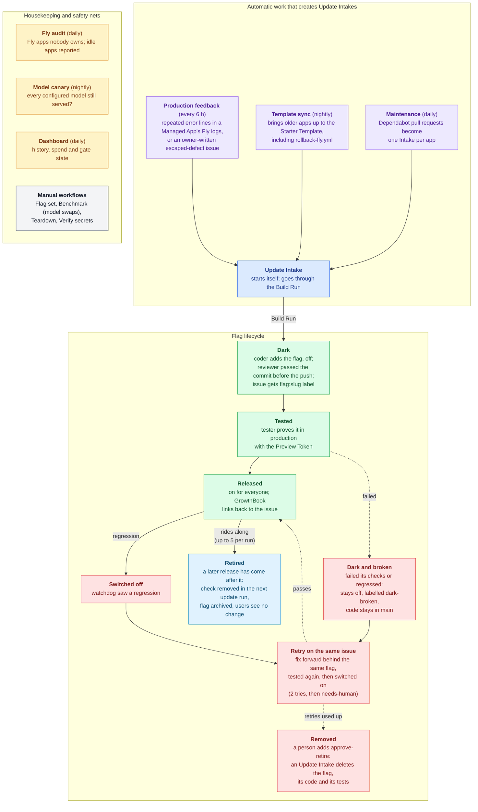

# Diagrams

Mermaid is the source for every diagram here: GitHub and the VS Code preview render it, and a change is a text diff. Make a PDF (or PNG) only when a diagram has to leave the repo, with `npx -y @mermaid-js/mermaid-cli -i docs/diagrams.md -o out.pdf`.

Colours: green is a model Agent, grey is deterministic Python (the Orchestrator), amber is CI and deploy, red is a bad ending, purple is automatic work or the Factory itself.

## 1. The Build Run: how a request becomes a released change

One GitHub Actions run per request. Nothing is pushed until the reviewer has passed the commit; the push deploys it dark; the tester then says what a failure means.

```mermaid
flowchart TD
  owner["<b>Owner</b><br/>files an Intake or Update Intake<br/>as a GitHub issue, adds a label"]:::human
  auto["<b>Automatic sources</b><br/>production feedback, template sync,<br/>maintenance, retries"]:::auto
  wf["<b>update-intake.yml / app-staging.yml</b><br/>check the issue, stage a new app,<br/>dispatch build-run.yml"]:::human
  setup["<b>0 Setup and guards</b> (Orchestrator)<br/>secret scan, daily cap, model check and fallback,<br/>agent-isolation self-check, clone, npm ci,<br/>pick flags to retire"]:::det
  refused["<b>Refused</b><br/>real secret or infeasible request:<br/>answered on the issue, nothing built"]:::bad
  plan["<b>1 Plan</b><br/>Planner Agent<br/>change sets, criteria, one flag each"]:::agent
  code["<b>2 Code</b><br/>Coder Agent<br/>format first, then build and tests,<br/>commits locally. Nothing pushed yet"]:::agent
  rev["<b>3 Review before push</b><br/>Reviewer Agent, one call over the local diff<br/>blocked code never reaches main"]:::agent
  ci["<b>4 Push, CI, build, deploy (dark)</b><br/>Orchestrator pushes the reviewed commit<br/>Test Gate, image build, deploy to Fly<br/>Pipeline Agent diagnoses a failure;<br/>its fix is reviewed before it is pushed"]:::ci
  test["<b>5 Test</b> (deployed app, Preview Token)<br/>Tester Agent: new checks and<br/>existing-behaviour checks<br/>notes what failed; the helpers' log outranks it"]:::agent
  gate{"<b>Verdict by code</b><br/>CI green, deploy healthy,<br/>tester passed, reviewer clean,<br/>same commit"}:::det
  rel["<b>6 Release</b><br/>flag on in GrowthBook"]:::det
  dog["<b>7 Watchdog</b> (10 min)<br/>on a regression switch the flag off"]:::det
  fin["<b>8 Finalize</b><br/>Report, Summary, State issue, ledger"]:::det
  bad["<b>Bad ending</b><br/>round limit, stuck, budget, crash, watchdog<br/>flag stays off: a dark feature,<br/>fixed forward, nothing reverted"]:::bad
  rb["<b>Regression found</b><br/>the app's CI redeploys the<br/>previous version (rollback-fly.yml)<br/>commits stay in main"]:::bad
  retro["<b>Retrospective</b> (every run)<br/>notes bugs on the story issue, files<br/>improvements (no duplicates),<br/>names the cause, comments a summary"]:::agent
  retry["<b>Same issue, same flag</b><br/>retried up to 2 times, then<br/>needs-human + dark-broken;<br/>a person adds approve-retire to remove it"]:::bad
  fac["<b>Factory fix request</b><br/>a pull request for a person to merge"]:::auto

  owner --> wf
  auto --> wf
  wf --> setup
  setup -- refused --> refused
  setup --> plan --> code --> rev
  rev -. "blocking findings,<br/>nothing pushed" .-> code
  rev -- "clean: push" --> ci --> test --> gate
  gate -. "dark failure: fix forward<br/>(max 4 rounds, 2 failed deployed tests, stuck detector,<br/>cost cap, 330 min limit)" .-> code
  gate -- clean --> rel --> dog --> fin
  gate -.-> bad
  test -. regression .-> rb
  bad --> retro
  rb --> retro
  fin --> retro
  retro --> retry
  retro --> fac

  classDef agent fill:#dcfce7,stroke:#16a34a,color:#14532d
  classDef det fill:#f3f4f6,stroke:#374151,color:#111827
  classDef ci fill:#fef3c7,stroke:#d97706,color:#78350f
  classDef bad fill:#fee2e2,stroke:#dc2626,color:#7f1d1d
  classDef auto fill:#ede9fe,stroke:#7c3aed,color:#4c1d95
  classDef human fill:#dbeafe,stroke:#2563eb,color:#1e3a8a
```

## 2. Components and where they run

Nothing runs continuously: each Build Run is a short-lived GitHub Actions VM. State lives in GitHub issues.

## 3. Agents, models and what each may do

Models are set per role in [agents/profiles.yml](../agents/profiles.yml), each with a fallback used if the provider stops serving it. Verdicts come from code, never from a model's own label.

| Role | Model (lab) | Fallback | Does | Output the Orchestrator checks |
|---|---|---|---|---|
| Planner | Qwen3-Coder-480B (Alibaba) | DeepSeek-V4.1-Flash | Judges feasibility, splits a request into change sets with criteria and a flag each | `plan.json`, validated (reuses a retry's flag) |
| Coder | DeepSeek-V4.1-Flash (DeepSeek) | Qwen3-Coder-480B | Formats, then writes the change and its tests behind one flag; retires proven flags; commits locally | commits (protected files and flag leftovers rejected) |
| Reviewer | DeepSeek-V4.1-Flash (single call) | Qwen3-Coder-480B | Reads the local diff, flags and spec before the push; raises blocking or minor findings and suggests improvements | findings; clean = no blocking |
| Tester | Nemotron-3-Ultra 550B (NVIDIA) | Qwen3-Coder-480B | Exercises the deployed app with the Preview Token; tags checks `new` or `existing`; states checks as data for the helpers; notes failures and suggests improvements | report, reconciled with the helpers' logs |
| Pipeline | Qwen3-Coder-480B | DeepSeek-V4.1-Flash | Diagnoses a failed CI, build or deploy | diagnosis, then a coder fix (reviewed before push) |
| Retrospective (also Factory Run) | Qwen3-Coder-480B | DeepSeek-V4.1-Flash | Runs after every run: names why a run failed; proposes a Factory fix as a pull request | cause category, validated changes only |

| Deterministic component (no model) | Does |
|---|---|
| Orchestrator | stage order, limits, cost caps, verdicts, push, CI rollback of a regression, release, watchdog, ledger, finalize, and filing the bugs and improvements the retrospective collects |
| api-check, ui-check | make the requests and drive the browser, compare to the stated expectation, log every result; a failure they saw cannot be reported as a pass |
| Triage | secret scan; refuses a request the Factory cannot build before anything is built |
| Release and watchdog | flag on after the gates pass; flag off on a regression; archived when retired |
| Scheduled passes | production feedback, template sync, maintenance, Fly audit, model canary, dashboard |

Guardrails on every Agent:
- A scoped model key capped at what is left of the run's cost cap ($2 default, $10 ceiling) and a $10 daily spend cap across runs.
- A whitelisted environment with no PAT, Fly token or GrowthBook key, and a separate operating-system account, checked at the start of every run.
- Killed after 8 silent minutes (45 overall); a read-only role that touches the tree is reset; at most 4 review rounds, a stuck detector, a 330-minute run limit.
- Nothing is reverted in git: a bad ending is fixed forward, and only a regression rolls the deploy back through CI. A request with a secret or one the Factory cannot build is refused before anything is built.

## 4. One story, one flag, and the automation around it

A flag exists only to stage a change and release it when it is safe. It lives and dies with its story (the GitHub issue).

