# The flow: the numbered spec

This is the official specification of how a request becomes a running, recorded change. Every step has a stable ID (`group.step`, for example `STEP 4.9`, Test the deployed app) so that docs, tickets, tests and verification runs can cite it. [ARCHITECTURE.md](../ARCHITECTURE.md) explains the parts; where it disagrees with this page, this page is the intended behaviour and ARCHITECTURE.md is brought into line. This is the only flow diagram kept in the repo; the older ones were deleted, and a new one is drawn only when it is needed.

**Status.** This is the workflow the code implements. The failure-to-ticket path (6.7, 7.1, 7.6, 8.x) is built (tickets 15b to 15d and 16); the live proof is ticket 17. The plan, order of work and the tickets that close each gap are in `.wayfinder/intake-planning-redesign/`. The "Implemented by" and "Verified by" columns are filled as each group is built and then checked in the last ticket.

**Domains.** Each numbered group is a domain with its own folder under `orchestrator/` (see [orchestrator-map.md](orchestrator-map.md)): 1 Request (`request`), 2 Planning (`planning`), 3 Staging (`staging`), 4 Build Run (`build_run`), 5 Flag Lifecycle (`flag_lifecycle`), 6 Retrospective (`retrospective`, record and advance included), 7 Try Fix (`try_fix`), 8 Bugs (`bugs`). Maintenance and Monitoring have no steps.

**Rules for changing this page.**
- IDs are stable. Never renumber a step; add the next free number in its domain, or retire an ID by leaving it in the index marked retired.
- Cite a step as `STEP n.m` in any doc; `flow_spec_test.py` fails when a cited ID does not exist, when the diagram and the index disagree, or when an invariant's Step names a step that does not exist.
- An invariant in [invariants.md](invariants.md) names the step it enforces in its Step column.

## Diagram

```mermaid
flowchart TD
    subgraph g1["1. Request"]
        S1_1["<b>1.1 New App Intake submitted</b><br/>owner form, label new-app-intake"]
        S1_2["<b>1.2 Update App Intake submitted</b><br/>owner form, label update-app-intake"]
        S1_3["<b>1.3 Automated change request</b><br/>template sync, maintenance, retirement,<br/>bug Intakes written by Try Fix<br/>filed with the PAT, label update-app-intake"]
    end

    S1_1 --> S2_1
    S1_2 --> S2_1
    S1_3 --> S2_1

    subgraph g2["2. Planning (plan.yml, its own process)"]
        S2_1["<b>2.1 Plan</b><br/>Planner Agent<br/>new app: reads the spec only<br/>update: reads the app's code"]
        S2_2["<b>2.2 Refuse</b><br/>comment: refused"]
        S2_3["<b>2.3 Stop for a person</b><br/>comment on the issue<br/>fix it, remove and re-add the label"]
        S2_4["<b>2.4 File child tickets</b><br/>sub-issues under the parent<br/>each body = complete coding instructions<br/>one flag each, sized to roll back alone"]
        S2_5["<b>2.5 Start the first child</b><br/>planner puts proceed-with-change<br/>on the first child with no dependencies"]
        S2_6{"<b>2.6 Route the child</b><br/>by kind"}
        S2_1 -->|"feasibility blocked"| S2_2
        S2_1 -->|"blocking question, bad plan,<br/>or missing secret"| S2_3
        S2_1 -->|"valid plan"| S2_4
        S2_4 --> S2_5
        S2_5 --> S2_6
    end

    S2_3 -.->|"retry"| S2_1

    subgraph g3["3. Staging (new app only, child 1)"]
        S3_1["<b>3.1 Stage the app</b><br/>stage.sh: repo from Starter, Fly app,<br/>flag service, Intake marker"]
        S3_2["<b>3.2 Verify infrastructure</b><br/>CI green, deploy healthy, flag round trip,<br/>preview token, secrets, smoke test<br/>deterministic checks, no Agent<br/>no business logic, no flag<br/>then the staging child closes and the first business child starts"]
        S3_1 --> S3_2
    end

    S2_6 -->|"staging"| S3_1

    subgraph g4["4. Build (every other child)"]
        S4_1["<b>4.1 Prepare the run</b><br/>read the child body only<br/>Orchestrator ensures flag issue-N exists, OFF"]
        S4_2["<b>4.2 Retire ride-along flags</b><br/>up to 5, oldest first,<br/>never a run of their own"]
        S4_3["<b>4.3 Code</b><br/>CODER Agent commits locally behind the flag<br/>format, build, unit tests incl. flag off and on"]
        S4_4["<b>4.4 Pre-review check</b><br/>Orchestrator: npm run check<br/>type-check, lint, flag off/on test check"]
        S4_5["<b>4.5 Review</b><br/>REVIEWER Agent reads the local commit<br/>BEFORE anything is pushed"]
        S4_6["<b>4.6 Push</b><br/>Orchestrator pushes with the PAT"]
        S4_7["<b>4.7 CI and dark deploy</b><br/>app CI: Test Gate, then deploy DARK<br/>flag off, nothing visible to users"]
        S4_8["<b>4.8 Diagnose pipeline failure</b><br/>PIPELINE Agent reads the logs<br/>coder fixes, reviewed again before any push"]
        S4_9["<b>4.9 Test the deployed app</b><br/>TESTER Agent runs AFTER the push<br/>Preview Token reaches the dark feature<br/>api-check and ui-check record every result<br/>repo tests, spot-check of behaviour that was live<br/>each check: passed / failed / blocked / not_run<br/>scope: new or existing"]
        S4_10["<b>4.10 Retest</b><br/>look again at the same deployed commit<br/>(test_retries 1), then needs-human"]
        S4_11["<b>4.11 Roll back the deploy</b><br/>rollback-fly: redeploy previous image<br/>flag stays off"]
        S4_12{"<b>4.12 Release gate</b><br/>CI green, deploy healthy,<br/>tester passed, reviewer clean,<br/>same SHA reviewed and pushed"}
        S4_13["<b>4.13 Release</b><br/>existing flag issue-N turned ON<br/>story labelled flag:issue-N<br/>watchdog watches the release"]
        S4_14["<b>4.14 Child fails</b><br/>child stays open, siblings keep waiting"]

        S4_1 --> S4_3
        S4_1 -.->|"at the start of every Build Run"| S4_2
        S4_3 --> S4_4
        S4_4 -->|"fails: back, costs no review"| S4_3
        S4_4 --> S4_5
        S4_5 -->|"blocking findings"| S4_3
        S4_5 -->|"clean"| S4_6
        S4_6 --> S4_7
        S4_7 -->|"CI or deploy fails"| S4_8
        S4_8 --> S4_3
        S4_7 --> S4_9
        S4_9 -->|"failed new check, rounds left<br/>(review_rounds 4, test_rounds 2)"| S4_3
        S4_9 -->|"blocked or not_run"| S4_10
        S4_10 --> S4_9
        S4_9 -->|"existing behaviour broke = regression"| S4_11
        S4_11 --> S4_14
        S4_9 -->|"all checks passed"| S4_12
        S4_9 -->|"rounds, cost cap or time limit used up,<br/>or same failures repeat (stuck)"| S4_14
        S4_12 -->|"pass"| S4_13
        S4_12 -->|"a gate does not hold"| S4_14
    end

    S2_6 -->|"update"| S4_1

    subgraph g5["5. Flag lifecycle (short-lived by design)"]
        S5_1["<b>5.1 Dark</b><br/>flag off, code deployed"]
        S5_2["<b>5.2 Released</b><br/>flag ON for everyone"]
        S5_3["<b>5.3 Eligible for retirement</b>"]
        S5_4["<b>5.4 Retired</b><br/>coder deletes the flag check, the flag-off tests<br/>and the flags.json line in its own commit; unwraps flag-on tests<br/>verifier rejects the commit while issue-N appears anywhere<br/>TESTER checks the behaviour is still on for an ordinary visitor<br/>flag archived in GrowthBook, story comment says so"]
        S5_5["<b>5.5 Dark-broken candidate</b><br/>watchdog switched it off<br/>flag stays off; its child is failed and waits for a fix, then runs again behind it"]
        S5_6["<b>5.6 Owner approves retirement</b><br/>adds approve-retire to the story"]
        S5_7["<b>5.7 Retirement intake</b><br/>update-app-intake, planned, one child, no flag<br/>deletes check, code, tests, flags.json line<br/>nothing removes a dark feature on its own"]
        S5_1 --> S5_2
        S5_2 -->|"a LATER Build Run also ends released<br/>and at least 1 day has passed"| S5_3
        S5_3 --> S4_2
        S4_2 --> S5_4
        S5_2 -->|"watchdog switches it off"| S5_5
        S5_5 -->|"fixed and released"| S5_2
        S5_5 -->|"cause not fixable:<br/>needs-human + dark-broken"| S5_6
        S5_6 --> S5_7
        S5_7 --> S5_4
    end

    S4_13 --> S5_2
    S4_1 -.->|"flag created OFF"| S5_1

    S3_2 --> S6_1
    S4_13 --> S6_1

    subgraph g6["6. Record and advance"]
        S6_1["<b>6.1 Child closed</b>"]
        S6_2["<b>6.2 Retrospective</b><br/>finalize + retrospective Agent<br/>(every run, always)<br/>summary, lessons, names the cause<br/>and judges every event of the run:<br/>failures and warnings, verdict fix or record"]
        S6_3["<b>6.3 Advance to the next child</b><br/>next waiting child whose dependencies<br/>are closed gets proceed-with-change"]
        S6_4["<b>6.4 Parent closes</b><br/>last child closed"]
        S6_5(["<b>6.5 App live and recorded</b>"])
        S6_6["<b>6.6 Ongoing signals</b><br/>template sync, maintenance, owner requests"]
        S6_7["<b>6.7 Judge events with no run</b><br/>production errors, escaped defects,<br/>a failed staging check<br/>one batch per scan, same Agent and verdicts<br/>(a scan has no Build Run to finalize)"]
        S6_1 --> S6_2
        S6_2 -->|"child succeeded"| S6_3
        S6_3 -->|"last child closed"| S6_4
        S6_4 --> S6_5
        S6_5 --> S6_6
    end

    S4_14 --> S6_2
    S6_3 -->|"more children"| S2_6
    S6_6 --> S1_3
    S6_5 --> S1_2

    subgraph g7["7. Try fix (fix first, never retry the unchanged child)"]
        S7_6["<b>7.6 Write the bug ticket</b><br/>Try Fix Agent, one job: a good ticket<br/>from the bug template: how it was found,<br/>root cause, what it takes to resolve,<br/>numbered checkable requirements<br/>never decides cause or target, never plans"]
        S7_1["<b>7.1 File the bug Intake</b><br/>update-app-intake + bug, filed with the PAT<br/>planned by 2.1 like any Intake<br/>failed child: marker fix_for,<br/>exactly one child with a flag of its own, blocks the failed child<br/>released story: no marker, blocks nothing"]
        S7_2["<b>7.2 Factory fix request</b><br/>same bug template, in ai-factory<br/>factory-fix-request issue"]
        S7_3["<b>7.3 Learning PR</b><br/>auto-merge if additive lint/format,<br/>else a human"]
        S7_4["<b>7.4 Resume the failed child</b><br/>the bug Intake closes: the story gets a<br/>solution comment, the origin parent advances"]
        S7_5["<b>7.5 Needs human</b><br/>nothing runs until the owner edits and re-labels"]
        S7_2 --> S7_3
        S7_3 -->|"merged; template sync carries it to the app"| S7_4
        S7_6 --> S7_1
        S7_6 -->|"factory target"| S7_2
        S7_1 -->|"bug Intake closes"| S7_4
    end

    S6_2 -->|"verdict fix, app cause<br/>(code wrong, spec ambiguous)"| S7_6
    S6_7 -->|"verdict fix"| S7_6
    S7_1 -->|"plan the bug Intake"| S2_1
    S6_2 -->|"verdict fix, factory cause<br/>(prompt, template, orchestrator)"| S7_6
    S6_2 -->|"no cause found / infrastructure"| S7_5
    S7_4 --> S4_1
    S3_2 -->|"a check fails"| S6_7

    subgraph g8["8. Bugs found later"]
        S8_1["<b>8.1 Bug while still dark</b><br/>flag never released, off,<br/>or switched off by the watchdog:<br/>failure comment on the same story,<br/>the open child waits for its fix"]
        S8_2["<b>8.2 Validated release</b><br/>flag released and still on:<br/>feature is fully released"]
        S8_3["<b>8.3 Watch production</b><br/>watchdog, production feedback<br/>Fly errors, escaped-defect issue<br/>each finding becomes an event"]
        S8_4["<b>8.4 Regression</b><br/>a bug now is a REGRESSION:<br/>new bug Intake, nothing waits,<br/>comment on the story linking it"]
        S8_3 --> S8_1
        S8_3 --> S8_2
        S8_2 -->|"a bug now"| S8_4
    end

    S6_5 --> S8_3
    S8_3 -->|"events"| S6_7
    S8_1 -->|"how to file: fix_for"| S7_1
    S8_4 -->|"how to file: no marker"| S7_1
    S5_5 -.-> S8_1
```

## Step index

"Implemented by" names the tickets that built the step (the domain tickets in `.wayfinder/intake-planning-redesign/`); "Verified by" names its unit tests, its invariants (INV-n) and what was seen live (ai-factory#140 and #145 on `factory-bench`, 2026-10-20). Walked in ticket 18; the gaps it found are ticket 19 (open) and ticket 20 (closed), and the steps with no live sighting are listed in ticket 17.

| ID | Title | Actor | Main code today (or new) | Implemented by | Verified by |
|---|---|---|---|---|---|
| 1.1 | New App Intake submitted | owner | `ISSUE_TEMPLATE/new-app-intake.yml` | 06 | live #140 (the form's issue shape only; no unit test of the form) |
| 1.2 | Update App Intake submitted | owner | `ISSUE_TEMPLATE/update-app-intake.yml` | 06, 13 | INV-22; plan_run_test; live #145 |
| 1.3 | Automated change request | maintenance, template_sync, flag_lifecycle, try_fix | each module's `file_*`, `try_fix/file_bug.py` | 06, 15d | INV-33, INV-35; maintenance tests; file_bug_test; live: scheduled sources only, no bug Intake yet |
| 2.1 | Plan | Planner Agent | `planning/plan_run.py` (`plan.yml`), `planning/validate_plan.py` | 09, 13 | plan_run_test, validate_plan_test; INV-54, INV-56; live #140 (four attempts), #145 |
| 2.2 | Refuse | Orchestrator | `planning/triage.feasibility`, `Refused` | 09, 13 | triage tests, refusal_test; INV-40; no live refusal |
| 2.3 | Stop for a person | Orchestrator | `NeedsHuman`, `AwaitingSecret` | 09, 13 | plan_run_test, secrets_check_test; INV-48; live: needs_human twice on #140 |
| 2.4 | File child tickets | Orchestrator | `planning/file_children.py`, `shared/child_tickets.py` | 09 | file_children_test, child_tickets_test; INV-54, INV-56; live #140, #145 |
| 2.5 | Start the first child | Orchestrator | `retrospective/close_child.ready_to_start` | 09, 10 | close_child_test (ready_to_start); INV-24; live: #141, #146 started by the planner, #142, #147 by the advance |
| 2.6 | Route the child | Orchestrator | `factory-plan` marker `kind` | 12, 14 | staging/route_child_test, INV-57, INV-61; live #140, #145 |
| 3.1 | Stage the app | stage.sh | `infra/app-staging/stage.sh`, `staging/read_staging_child.py` | 14 | stage_script_test, read_staging_child_test; INV-57; live #141 |
| 3.2 | Verify infrastructure | Orchestrator | `staging/verify_infrastructure.py` | 14 | verify_infrastructure_test; INV-57; live #141 (six checks passed) |
| 4.1 | Prepare the run | Orchestrator | `build_run/prepare_run.py`, `flag_lifecycle/flag_slug.ensure_feature` | 08b, 11, 12 | prepare_run_test; INV-10, INV-18, INV-50, INV-51, INV-55; live #142 (flag issue-142) |
| 4.2 | Retire ride-along flags | Orchestrator, Coder | `flag_lifecycle.retirement_selection.piggyback_slugs` | 08c | retirement_selection_test; INV-37; no live run with a ride-along flag |
| 4.3 | Code | Coder Agent | `agents/prompts/coder.md` | 11 | agent prompts; INV-01, INV-02, INV-09, INV-12, INV-13, INV-21, INV-32, INV-34, INV-41, INV-49; smoke-coder; live #142, #146 |
| 4.4 | Pre-review check | Orchestrator | `limits.precheck`, Starter `scripts/check-flags.mjs` | 08c | check-flags.mjs; INV-47, INV-53; live #142 |
| 4.5 | Review | Reviewer Agent | `reviewer.md`, `build_run/review_code.py` | 11 | review_code_test; INV-04, INV-11, INV-46; live #142 |
| 4.6 | Push | Orchestrator | `build_run/ship_code.py` | 11 | ship_code_test; INV-42; live #142 |
| 4.7 | CI and dark deploy | app CI | Starter workflows | Starter | INV-16 (Starter workflows, no kill switch); live #142 (CI and dark deploy) |
| 4.8 | Diagnose pipeline failure | Pipeline Agent | pipeline role | 11 | ship_code_test (the diagnosis, retries and coder fixes), run_test; INV-62; no live pipeline failure |
| 4.9 | Test the deployed app | Tester Agent | `tester.md`, `build_run/verify_deployed_app.py`, `shared/api_check.py`, `build_run/ui_check.py` | 11 | verify_deployed_app_test, api_check_test, ui_check_test; INV-05, INV-08, INV-28, INV-30, INV-36, INV-44; live #142 |
| 4.10 | Retest | Orchestrator | `limits.test_retries` | 11 | run_test (retests); no live retest |
| 4.11 | Roll back the deploy | Orchestrator | `rollback-fly.yml` | 11 | rollback_test; INV-25; no live regression |
| 4.12 | Release gate | Orchestrator | `build_run/gate_release.py` | 11 | gate_release_test; INV-03; live #142 |
| 4.13 | Release | Orchestrator | `build_run/gate_release.py`, `flag_lifecycle/` | 08, 11 | gate_release_test; INV-06, INV-07, INV-52; live #142 (clean watch; a trip not seen) |
| 4.14 | Child fails | Orchestrator | `retrospective/close_child.finish_update_intake` | 10, 11, 15d | finalize_test, close_child_test; INV-19, INV-29; live: #147 stopped provider_blocked and was left without the start label |
| 5.1-5.7 | Flag lifecycle | Orchestrator | `flag_lifecycle/`, `retrospective/app_state.py` | 08, 08b, 08c | flag_lifecycle tests, app_state_test; INV-37, INV-38, INV-43, INV-51, INV-53; live: 5.1, 5.2 (issue-142, issue-146); 5.3 to 5.7 not seen |
| 6.1 | Child closed | Orchestrator | `retrospective/close_child.finish_update_intake` | 10 | close_child_test; live #141, #142, #146 |
| 6.2 | Retrospective | Retrospective Agent | `retrospective/finalize.py`, `retrospective/run_retrospective.py`, `retrospective/cause.py`, `retrospective/event_verdicts.py` | 10, 15b | finalize_test, cause_test, event_verdicts_test; INV-14, INV-17, INV-20, INV-45, INV-58; live: released runs and one provider_blocked; no failure with a cause |
| 6.3 | Advance to the next child | Orchestrator | `retrospective/close_child.advance` | 10 | close_child_test; INV-23; live: #141 to #142, #146 to #147 |
| 6.4 | Parent closes | Orchestrator | `retrospective/close_child.advance` | 10 | close_child_test; live #140 |
| 6.5 | App live and recorded | Orchestrator | `retrospective/app_state.py` | 10 | app_state_test; live: the App State issue was not read |
| 6.6 | Ongoing signals | scheduled workflows | `template_sync`, `maintenance` | 07 | dependency_updates_test, template_sync_test; INV-33, INV-35; live: scheduled runs succeed daily |
| 6.7 | Judge events with no run | Retrospective Agent | `retrospective/judge_events.py`, `retrospective/event_verdicts.py` | 15b | judge_events_test, event_verdicts_test; INV-58; no live batch yet (production-feedback.yml runs every six hours) |
| 7.1 | File the bug Intake | Orchestrator | `try_fix/file_bug.py`, `planning/fix_for.py`, `retrospective/close_child.settle_fix` | 15, 15d | file_bug_test, file_failure_test; INV-26, INV-27, INV-39; no live bug Intake |
| 7.2 | Factory fix request | Orchestrator | `try_fix/factory_fix_request.py`, bug template (ticket 15c) | 15, 15d | factory_fix_request_test, file_bug_test; INV-26; no live Factory cause |
| 7.3 | Learning PR | Retrospective Agent | `factory-run.yml` | 10 | learning_pr_test; INV-15; no live learning PR in this redesign |
| 7.4 | Resume the failed child | Orchestrator | `retrospective/close_child.advance`, `try_fix/resume_after_merge.py` | 15, 15d | resume_after_merge_test, close_child_test (settle_fix); INV-27; no live resume |
| 7.5 | Needs human | Orchestrator | `try_fix/needs_human.py` | 15 | file_bug_test, file_failure_test; INV-27; live: only the provider alert (#148) |
| 7.6 | Write the bug ticket | Try Fix Agent | `try_fix/write_bug.py`, `try_fix/validate_bug.py`, `try_fix/render_bug.py` | 15c | write_bug_test, validate_bug_test, render_bug_test; INV-59; the model's tickets unmeasured |
| 8.1-8.4 | Bugs found later | bugs domain | `bugs/scan_production.py`, `bugs/scan_logs.py`, `bugs/escaped_defects.py`, `bugs/route_bug.py`, `bugs/to_event.py`, `bugs/flood_limits.py`; `try_fix/file_events.py` | 16 | bugs tests (scan_logs, flood_limits, route_bug, to_event, scan_production), file_events_test; INV-31, INV-60; no live production error |

## From a failure to a fix

One rule for every failure and warning, whatever found it (a failed child, a failed staging check, the watchdog, a production error, an escaped defect, a dark-only test failure, a check that could not be run). Each Agent has one job.

1. **An event.** Whatever finds it writes a failure event: source, severity (`failure` or `warning`), app, the story it belongs to if any, a fingerprint, a summary and the evidence. A Build Run's events come from its facts; a scan's events (8.3, a failed staging check 3.2) are handed to the Retrospective.
2. **A verdict (6.2, 6.7).** The Retrospective Agent alone names the cause and the target (`managed_app` or `factory`) and gives every event a verdict, `fix` or `record`, with a reason. A failure is always `fix`; a warning is `record` unless the Agent says why a fix is worth it. A scan with no Build Run is judged in one batch (6.7). `record` keeps today's learning record and files nothing; the Factory no longer files Suggestion issues in a Managed App's repo.
3. **A ticket (7.6).** The Try Fix Agent writes one bug ticket from the bug template for each `fix` verdict. It does not decide the cause or target, and it does not plan or split work. If it fails or its output does not validate, the Orchestrator writes the ticket from the facts.
4. **An Intake (7.1, 7.2).** The ticket is filed as an Intake and the planner plans it (2.1), so a fix has the same size and criteria limits as any change. An app fix is an `update-app-intake` labelled `bug`; a Factory fix is the same template in ai-factory.
5. **Dark or released.** If the story's flag was never released, is off, or was switched off by the watchdog (8.1), the failure is added as a comment on the story, the bug Intake carries `fix_for` (the failed child), the plan has exactly one child, an ordinary child with a flag of its own (or none), and the failed child waits on it. If the flag was released and is still on (8.2), a bug is a regression (8.4): a new bug Intake with no marker that nothing waits for, and the story gets a comment linking it.
6. **Closing the loop (7.4).** When the bug Intake closes, the story gets a solution comment and the origin parent advances; the failed child resumes through the normal advance and runs again behind its own flag, which already exists, off.
7. **Bounded.** A fix that fails is handled like any failed child: a follow-up bug Intake whose `fix_for` is the failed fix. Attempts are counted along that chain back to the original story; after `fix_attempts_max` (2) the child is held `needs-human` and nothing more is filed. One bug per event key.
