# The flow: the numbered spec

This is the official specification of how a request becomes a running, recorded change. Every step has a stable ID (`group.step`, for example `STEP 4.9`, Test the deployed app) so that docs, tickets, tests and verification runs can cite it. [ARCHITECTURE.md](../ARCHITECTURE.md) explains the parts; where it disagrees with this page, this page is the intended behaviour and ARCHITECTURE.md is brought into line. This is the only flow diagram kept in the repo; the older ones were deleted, and a new one is drawn only when it is needed.

**Status.** This is the target workflow. The code does not yet match all of it: planning still runs inside the Build Run, new apps are staged from the Intake text with no plan, and a failed child is retried unchanged. The plan, order of work and the tickets that close each gap are in `.wayfinder/intake-planning-redesign/`. The "Implemented by" and "Verified by" columns are filled as each group is built and then checked in the last ticket.

**Domains.** Each numbered group is a domain with its own folder under `orchestrator/` (see [orchestrator-map.md](orchestrator-map.md)): 1 Request (`request`), 2 Planning (`planning`), 3 Staging (`staging`), 4 Build Run (`build_run`), 5 Flag Lifecycle (`flag_lifecycle`), 6 Retrospective (`retrospective`, record and advance included), 7 Try Fix (`try_fix`), 8 Bugs (`bugs`). Maintenance and Monitoring have no steps.

**Rules for changing this page.**
- IDs are stable. Never renumber a step; add the next free number in its domain, or retire an ID by leaving it in the index marked retired.
- Cite a step as `STEP n.m` in any doc; `flow_spec_test.py` fails when a cited ID does not exist, when the diagram and the index disagree, or when an invariant's Step names a step that does not exist.
- An invariant in [invariants.md](invariants.md) names the step it enforces in its Step column.

## Diagram

```mermaid
flowchart TD
    subgraph g1["1. Request"]
        S1_1["<b>1.1 New App Intake submitted</b><br/>owner form, label new-app-intake"]
        S1_2["<b>1.2 Update App Intake submitted</b><br/>owner form, label update-app-intake"]
        S1_3["<b>1.3 Automated change request</b><br/>template sync, maintenance,<br/>production feedback, retirement<br/>filed with the PAT, label update-app-intake"]
    end

    S1_1 --> S2_1
    S1_2 --> S2_1
    S1_3 --> S2_1

    subgraph g2["2. Planning (plan.yml, its own process)"]
        S2_1["<b>2.1 Plan</b><br/>Planner Agent<br/>new app: reads the spec only<br/>update: reads the app's code"]
        S2_2["<b>2.2 Refuse</b><br/>comment: refused"]
        S2_3["<b>2.3 Stop for a person</b><br/>comment on the issue<br/>fix it, remove and re-add the label"]
        S2_4["<b>2.4 File child tickets</b><br/>sub-issues under the parent<br/>each body = complete coding instructions<br/>one flag each, sized to roll back alone"]
        S2_5["<b>2.5 Start the first child</b><br/>planner puts proceed-with-change<br/>on the first child with no dependencies"]
        S2_6{"<b>2.6 Route the child</b><br/>by kind"}
        S2_1 -->|"feasibility blocked"| S2_2
        S2_1 -->|"blocking question, bad plan,<br/>or missing secret"| S2_3
        S2_1 -->|"valid plan"| S2_4
        S2_4 --> S2_5
        S2_5 --> S2_6
    end

    S2_3 -.->|"retry"| S2_1

    subgraph g3["3. Staging (new app only, child 1)"]
        S3_1["<b>3.1 Stage the app</b><br/>stage.sh: repo from Starter, Fly app,<br/>flag service, Intake marker"]
        S3_2["<b>3.2 Verify infrastructure</b><br/>CI green, deploy healthy, flag round trip,<br/>preview token, secrets, smoke test<br/>no business logic, no flag<br/>TESTER Agent exercises the live app against the spec<br/>(first build, no flags: live on deploy)"]
        S3_1 --> S3_2
    end

    S2_6 -->|"staging"| S3_1

    subgraph g4["4. Build (every other child)"]
        S4_1["<b>4.1 Prepare the run</b><br/>read the child body only<br/>Orchestrator ensures flag issue-N exists, OFF"]
        S4_2["<b>4.2 Retire ride-along flags</b><br/>up to 5, oldest first,<br/>never a run of their own"]
        S4_3["<b>4.3 Code</b><br/>CODER Agent commits locally behind the flag<br/>format, build, unit tests incl. flag off and on"]
        S4_4["<b>4.4 Pre-review check</b><br/>Orchestrator: npm run check<br/>type-check, lint, flag off/on test check"]
        S4_5["<b>4.5 Review</b><br/>REVIEWER Agent reads the local commit<br/>BEFORE anything is pushed"]
        S4_6["<b>4.6 Push</b><br/>Orchestrator pushes with the PAT"]
        S4_7["<b>4.7 CI and dark deploy</b><br/>app CI: Test Gate, then deploy DARK<br/>flag off, nothing visible to users"]
        S4_8["<b>4.8 Diagnose pipeline failure</b><br/>PIPELINE Agent reads the logs<br/>coder fixes, reviewed again before any push"]
        S4_9["<b>4.9 Test the deployed app</b><br/>TESTER Agent runs AFTER the push<br/>Preview Token reaches the dark feature<br/>api-check and ui-check record every result<br/>repo tests, spot-check of behaviour that was live<br/>each check: passed / failed / blocked / not_run<br/>scope: new or existing"]
        S4_10["<b>4.10 Retest</b><br/>look again at the same deployed commit<br/>(test_retries 1), then needs-human"]
        S4_11["<b>4.11 Roll back the deploy</b><br/>rollback-fly: redeploy previous image<br/>flag stays off"]
        S4_12{"<b>4.12 Release gate</b><br/>CI green, deploy healthy,<br/>tester passed, reviewer clean,<br/>same SHA reviewed and pushed"}
        S4_13["<b>4.13 Release</b><br/>existing flag issue-N turned ON<br/>story labelled flag:issue-N<br/>watchdog watches the release"]
        S4_14["<b>4.14 Child fails</b><br/>child stays open, siblings keep waiting"]

        S4_1 --> S4_3
        S4_1 -.->|"at the start of every Build Run"| S4_2
        S4_3 --> S4_4
        S4_4 -->|"fails: back, costs no review"| S4_3
        S4_4 --> S4_5
        S4_5 -->|"blocking findings"| S4_3
        S4_5 -->|"clean"| S4_6
        S4_6 --> S4_7
        S4_7 -->|"CI or deploy fails"| S4_8
        S4_8 --> S4_3
        S4_7 --> S4_9
        S4_9 -->|"failed new check, rounds left<br/>(review_rounds 4, test_rounds 2)"| S4_3
        S4_9 -->|"blocked or not_run"| S4_10
        S4_10 --> S4_9
        S4_9 -->|"existing behaviour broke = regression"| S4_11
        S4_11 --> S4_14
        S4_9 -->|"all checks passed"| S4_12
        S4_9 -->|"rounds, cost cap or time limit used up,<br/>or same failures repeat (stuck)"| S4_14
        S4_12 -->|"pass"| S4_13
        S4_12 -->|"a gate does not hold"| S4_14
    end

    S2_6 -->|"update"| S4_1

    subgraph g5["5. Flag lifecycle (short-lived by design)"]
        S5_1["<b>5.1 Dark</b><br/>flag off, code deployed"]
        S5_2["<b>5.2 Released</b><br/>flag ON for everyone"]
        S5_3["<b>5.3 Eligible for retirement</b>"]
        S5_4["<b>5.4 Retired</b><br/>coder deletes the flag check, the flag-off tests<br/>and the flags.json line in its own commit; unwraps flag-on tests<br/>verifier rejects the commit while issue-N appears anywhere<br/>TESTER checks the behaviour is still on for an ordinary visitor<br/>flag archived in GrowthBook, story comment says so"]
        S5_5["<b>5.5 Dark-broken candidate</b><br/>watchdog switched it off<br/>flag stays, Try Fix reuses the SAME flag"]
        S5_6["<b>5.6 Owner approves retirement</b><br/>adds approve-retire to the story"]
        S5_7["<b>5.7 Retirement intake</b><br/>update-app-intake, planned, one child, no flag<br/>deletes check, code, tests, flags.json line<br/>nothing removes a dark feature on its own"]
        S5_1 --> S5_2
        S5_2 -->|"a LATER Build Run also ends released<br/>and at least 1 day has passed"| S5_3
        S5_3 --> S4_2
        S4_2 --> S5_4
        S5_2 -->|"watchdog switches it off"| S5_5
        S5_5 -->|"fixed and released"| S5_2
        S5_5 -->|"cause not fixable:<br/>needs-human + dark-broken"| S5_6
        S5_6 --> S5_7
        S5_7 --> S5_4
    end

    S4_13 --> S5_2
    S4_1 -.->|"flag created OFF"| S5_1

    S3_2 --> S6_1
    S4_13 --> S6_1

    subgraph g6["6. Record and advance"]
        S6_1["<b>6.1 Child closed</b>"]
        S6_2["<b>6.2 Retrospective</b><br/>finalize + retrospective Agent<br/>(every run, always)<br/>summary, lessons, names the cause"]
        S6_3["<b>6.3 Advance to the next child</b><br/>next waiting child whose dependencies<br/>are closed gets proceed-with-change"]
        S6_4["<b>6.4 Parent closes</b><br/>last child closed"]
        S6_5(["<b>6.5 App live and recorded</b>"])
        S6_6["<b>6.6 Ongoing signals</b><br/>template sync, maintenance, owner requests"]
        S6_1 --> S6_2
        S6_2 -->|"child succeeded"| S6_3
        S6_3 -->|"last child closed"| S6_4
        S6_4 --> S6_5
        S6_5 --> S6_6
    end

    S4_14 --> S6_2
    S6_3 -->|"more children"| S2_6
    S6_6 --> S1_3
    S6_5 --> S1_2

    subgraph g7["7. Try fix (fix first, never retry the unchanged child)"]
        S7_1["<b>7.1 Fix child</b><br/>planner files it under the same parent,<br/>ahead of the failed one<br/>complete body, behind the SAME flag"]
        S7_2["<b>7.2 Factory fix request</b><br/>factory-fix-request issue"]
        S7_3["<b>7.3 Learning PR</b><br/>auto-merge if additive lint/format,<br/>else a human"]
        S7_4["<b>7.4 Resume the failed child</b><br/>PAT re-adds proceed-with-change"]
        S7_5["<b>7.5 Needs human</b><br/>nothing runs until the owner edits and re-labels"]
        S7_2 --> S7_3
        S7_3 -->|"merged; template sync carries it to the app"| S7_4
        S7_1 -->|"fix child closes"| S7_4
    end

    S6_2 -->|"failed: app cause<br/>(code wrong, spec ambiguous)"| S7_1
    S7_1 -->|"proceed-with-change"| S2_6
    S6_2 -->|"failed: factory cause<br/>(prompt, template, orchestrator)"| S7_2
    S6_2 -->|"no cause found / infrastructure"| S7_5
    S7_4 --> S4_1

    subgraph g8["8. Bugs found later"]
        S8_1["<b>8.1 Bug while still dark</b><br/>flag dark or off, not validated yet"]
        S8_2["<b>8.2 Validated release</b><br/>flag on and validated:<br/>feature is fully released"]
        S8_3["<b>8.3 Watch production</b><br/>watchdog, production feedback<br/>Fly errors, escaped-defect issue"]
        S8_4["<b>8.4 Regression issue</b><br/>new update-app-intake labelled bug<br/>for tracking and analysis"]
        S8_3 --> S8_1
        S8_3 --> S8_2
        S8_2 -->|"a bug now is a REGRESSION"| S8_4
    end

    S6_5 --> S8_3
    S8_1 -->|"same issue stays open,<br/>more iteration"| S6_2
    S8_4 --> S2_1
    S5_5 -.-> S8_1
```

## Step index

| ID | Title | Actor | Main code today (or new) | Implemented by | Verified by |
|---|---|---|---|---|---|
| 1.1 | New App Intake submitted | owner | `ISSUE_TEMPLATE/new-app-intake.yml` |  |  |
| 1.2 | Update App Intake submitted | owner | `ISSUE_TEMPLATE/update-app-intake.yml` |  |  |
| 1.3 | Automated change request | production_feedback, maintenance, template_sync, flag_lifecycle | each module's `file_*` |  |  |
| 2.1 | Plan | Planner Agent | new `plan_run.py` (from `plan_change`), `planning/validate_plan.py` |  |  |
| 2.2 | Refuse | Orchestrator | `planning/triage.feasibility`, `Refused` |  |  |
| 2.3 | Stop for a person | Orchestrator | `NeedsHuman`, `AwaitingSecret` |  |  |
| 2.4 | File child tickets | Orchestrator | `planning/file_children.py`, `shared/child_tickets.py` |  |  |
| 2.5 | Start the first child | Orchestrator | `retrospective/close_child.ready_to_start` |  |  |
| 2.6 | Route the child | Orchestrator | `factory-plan` marker `kind` |  |  |
| 3.1 | Stage the app | stage.sh | `infra/app-staging/stage.sh` |  |  |
| 3.2 | Verify infrastructure | Orchestrator, Tester | Starter smoke test, tester |  |  |
| 4.1 | Prepare the run | Orchestrator | `build_run/prepare_run.py`, `flag_lifecycle/flag_slug.ensure_feature` |  |  |
| 4.2 | Retire ride-along flags | Orchestrator, Coder | `flag_lifecycle.retirement_selection.piggyback_slugs` |  |  |
| 4.3 | Code | Coder Agent | `agents/prompts/coder.md` |  |  |
| 4.4 | Pre-review check | Orchestrator | `limits.precheck`, Starter `scripts/check-flags.mjs` |  |  |
| 4.5 | Review | Reviewer Agent | `reviewer.md`, `build_run/review_code.py` |  |  |
| 4.6 | Push | Orchestrator | `build_run/ship_code.py` |  |  |
| 4.7 | CI and dark deploy | app CI | Starter workflows |  |  |
| 4.8 | Diagnose pipeline failure | Pipeline Agent | pipeline role |  |  |
| 4.9 | Test the deployed app | Tester Agent | `tester.md`, `build_run/verify_deployed_app.py`, `shared/api_check.py`, `build_run/ui_check.py` |  |  |
| 4.10 | Retest | Orchestrator | `limits.test_retries` |  |  |
| 4.11 | Roll back the deploy | Orchestrator | `rollback-fly.yml` |  |  |
| 4.12 | Release gate | Orchestrator | `build_run/gate_release.py` |  |  |
| 4.13 | Release | Orchestrator | `build_run/gate_release.py`, `flag_lifecycle/` |  |  |
| 4.14 | Child fails | Orchestrator | `retrospective/close_child.finish_update_intake` |  |  |
| 5.1-5.7 | Flag lifecycle | Orchestrator | `flag_lifecycle/`, `retrospective/app_state.py` |  |  |
| 6.1 | Child closed | Orchestrator | `retrospective/close_child.finish_update_intake` |  |  |
| 6.2 | Retrospective | Retrospective Agent | `retrospective/finalize.py`, `retrospective/run_retrospective.py`, `retrospective/cause.py` |  |  |
| 6.3 | Advance to the next child | Orchestrator | `retrospective/close_child.advance` |  |  |
| 6.4 | Parent closes | Orchestrator | `retrospective/close_child.advance` |  |  |
| 6.5 | App live and recorded | Orchestrator | `retrospective/app_state.py` |  |  |
| 6.6 | Ongoing signals | scheduled workflows | `template_sync`, `maintenance` |  |  |
| 7.1 | Fix child | Planner | new, in `try_fix/fix_request.py` |  |  |
| 7.2 | Factory fix request | Orchestrator | `try_fix/fix_request.py` |  |  |
| 7.3 | Learning PR | Retrospective Agent | `factory-run.yml` |  |  |
| 7.4 | Resume the failed child | Orchestrator | new, in `try_fix/fix_request.py` |  |  |
| 7.5 | Needs human | Orchestrator | `needs-human` label |  |  |
| 8.1-8.4 | Bugs found later | production_feedback | `production_feedback.py` |  |  |
