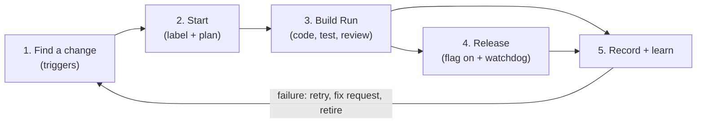
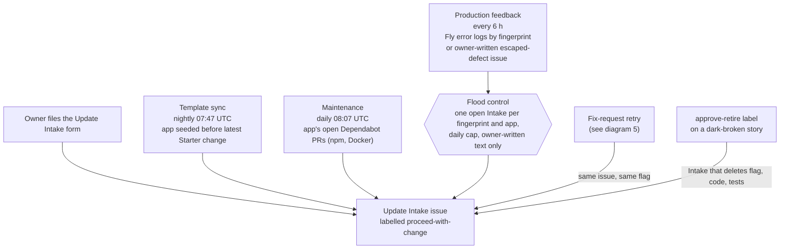
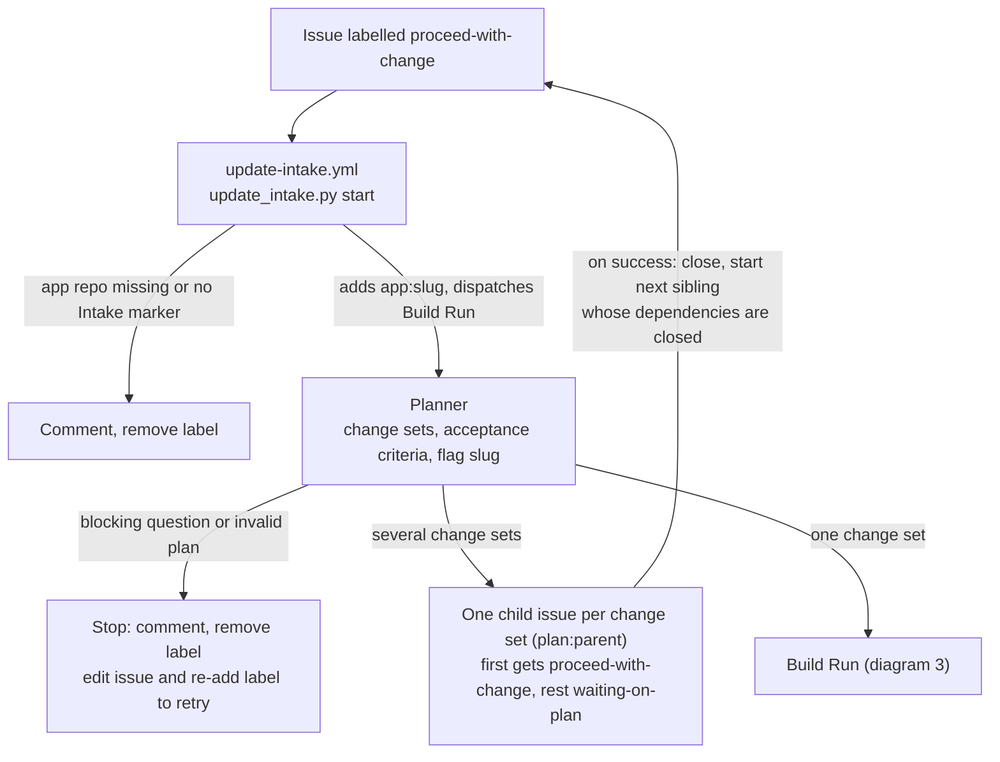
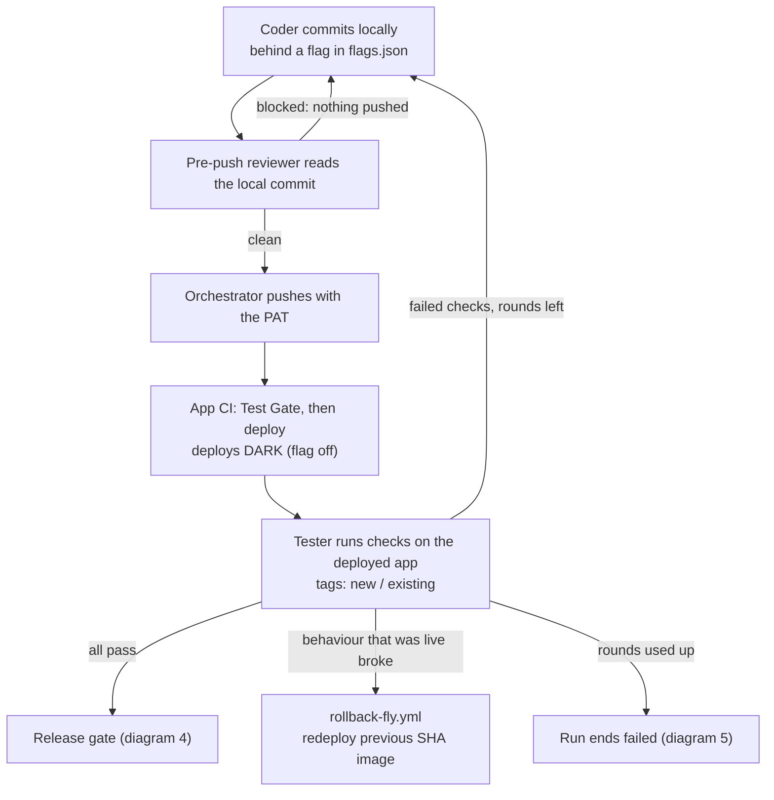
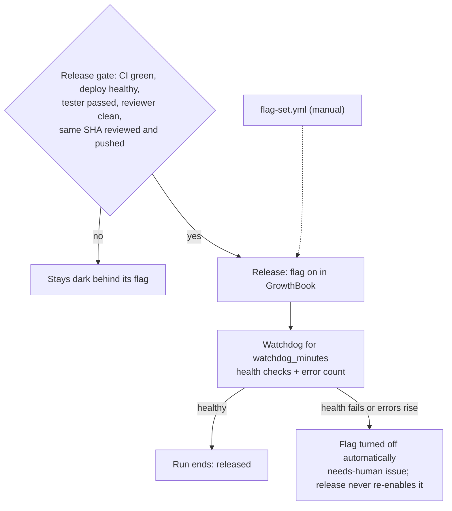
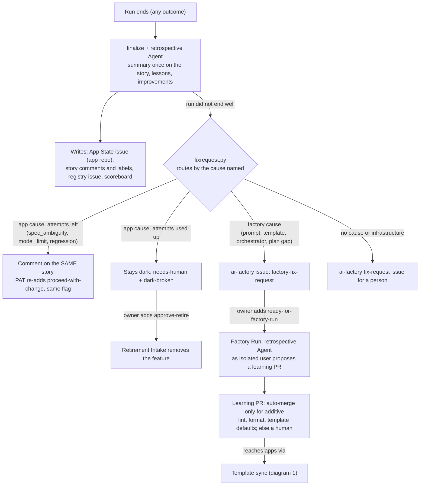

# How the Orchestrator finds and applies updates to Managed Apps

Sources: `ARCHITECTURE.md` (Intake, Update Intake), `.github/workflows/*.yml`, `orchestrator/{template_sync,maintenance,production_feedback,update_intake,fixrequest,flag_retirement}.py`, `orchestrator/build_run.py`.

Five small diagrams, each one stage. Whatever finds a change, it ends as an `update-intake` issue that gets `proceed-with-change`, and the same Build Run handles it. Nothing edits an app directly.

## 0. The whole thing in one line each

## 1. What finds a change

Each one files an Update Intake issue in ai-factory and puts `proceed-with-change` on it with the PAT (labels added with the Actions token would not start workflows).

## 2. Start and plan

## 3. Build Run: code, deploy dark, test

One Build Run per app at a time (`concurrency: build-run-<app>`).

## 4. Release and watchdog

## 5. Record, learn, retry

